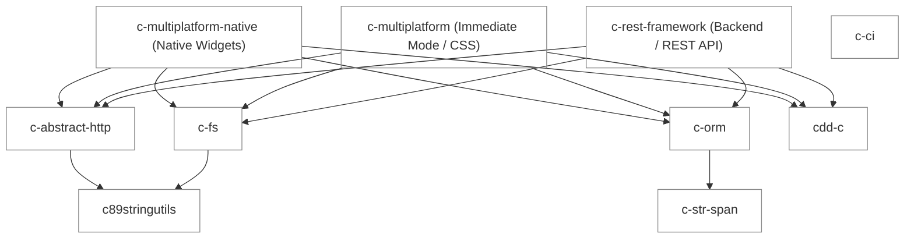

# C Multiplatform Native (cmn)

[](https://opensource.org/licenses/Apache-2.0)
 

`cmn` (C Multiplatform Native) is a lightweight, high-performance, and entirely native GUI framework written in strict C90. It provides a unified API for building cross-platform native graphical user interfaces across desktop, mobile, and web (WASM) without sacrificing platform-specific look and feel or binary size.

---

## 🌟 Core Features

- **Truly Native Interfaces**: Uses native OS windowing and UI toolkits under the hood (Win32, Cocoa, GTK, Android SDK, iOS UIKit, Web DOM).
- **Strict C90 Conformance**: Builds with the widest possible range of compilers, ensuring unmatched portability.
- **Modern State Management**: Includes an Angular-inspired reactive `Signals` system for state management (`cmn/signals.h`).
- **Routing & Navigation**: Features a robust SPA-style router with deep linking support (`cmn/router.h`), ideal for building complex multi-view applications.
- **Form Management**: Built-in validation, debounce support, and multi-step (wizard) workflows (`cmn/form.h`).
- **Accessibility (a11y) & Internationalization (i18n)**: Out-of-the-box support for screen readers, RTL languages, and tab-indexing (`cmn/a11y_i18n.h`).
- **UI Automation & Testing**: First-class support for programmatic interaction, screenshot capturing, and keyboard simulation for comprehensive regression testing (`cmn/automation.h`).
- **Memory & Error Safety**: Clean, predictable error-code-based return types with built-in safe string manipulation primitives.

## 🚀 Supported Platforms & Compilers

**Operating Systems:**
- **Windows**: Win32 API
- **macOS**: Cocoa / Objective-C
- **Linux**: Native toolkits (e.g., GTK)
- **iOS**: UIKit
- **Android**: Android NDK / JNI
- **Web**: WebAssembly (WASM)

**Compilers:**
- **GCC**
- **Clang** / Apple Clang
- **MSVC** (Microsoft Visual C++)

*Note: Built with highest strictness levels (`-Wall -Wextra -Wpedantic -Werror` or `/W4 /WX`).*

## 🛠️ Build & Installation

The project uses **CMake** (v3.14+).

### CMake Options

| Option | Default | Description |
|--------|---------|-------------|
| `${PROJECT_NAME}_CRT_LINKAGE` | `Shared` | MSVC CRT Linkage: `Static` (`/MT`) vs `Shared` (`/MD`) |
| `${PROJECT_NAME}_CHARSET` | `UNICODE` | Charset: `UNICODE` vs `ANSI` |
| `${PROJECT_NAME}_THREADING` | `Multi-threaded` | Threading model |
| `${PROJECT_NAME}_LTO` | `OFF` | Enable Link-Time Optimization |
| `BUILD_SHARED_LIBS` | `OFF` | Build as Shared/Dynamic Library (`.dll`, `.so`, `.dylib`) |
| `CMN_ENABLE_ASAN` | `OFF` | Enable AddressSanitizer (GCC/Clang) |
| `CMN_ENABLE_UBSAN`| `OFF` | Enable UndefinedBehaviorSanitizer (GCC/Clang) |
| `CMN_ENABLE_COVERAGE` | `OFF` | Enable coverage reporting |

### Building from Source

```bash
mkdir build && cd build
cmake .. -Dcmn_LTO=ON -DCMAKE_BUILD_TYPE=Release
cmake --build .
```

Dependencies are automatically fetched via CMake `FetchContent`:
- [c-ci](https://github.com/SamuelMarks/c-ci)
- [c-fs](https://github.com/SamuelMarks/c-fs)
- [c-abstract-http](https://github.com/SamuelMarks/c-abstract-http)
- [c-orm](https://github.com/SamuelMarks/c-orm)
- [cdd-c](https://github.com/SamuelMarks/cdd-c)

## 💡 Example Usage

Below is a snippet demonstrating application initialization, window creation, and router registration.

```c
#include <cmn/app.h>
#include <cmn/widget.h>
#include <cmn/router.h>
#include <cmn/error.h>

int main(void) {
    cmn_app_t *app = NULL;
    cmn_window_t *win = NULL;
    cmn_router_t *router = NULL;

    /* 1. Initialize application */
    cmn_app_create(&app);

    /* 2. Create the main window */
    cmn_window_create(app, &win);
    cmn_window_set_title(win, "Hello cmn");

    /* 3. Initialize routing for the window */
    cmn_router_create(win, &router);
    
    /* 
     * cmn_router_register(router, "/home", home_view_factory, NULL);
     * cmn_router_navigate(router, "/home");
     */

    /* 4. Show window and run event loop */
    cmn_window_show(win);
    cmn_app_run(app);

    /* 5. Cleanup */
    cmn_router_destroy(&router);
    cmn_window_destroy(&win);
    cmn_app_destroy(&app);

    return 0;
}
```

*See `examples/simple_password_flow` for a complete example featuring state management and routing.*

## ⚖️ `c-multiplatform-native` vs. `c-multiplatform`: Which Should You Choose?

This repository (`c-multiplatform-native` / `cmn`) is the **retained-mode native OS widget** framework, whereas **[c-multiplatform](https://github.com/SamuelMarks/c-multiplatform)** is its sister **immediate-mode / custom-rendered** UI framework.

Both are written in strict ANSI C (C89/C90), expose zero-overhead C ABIs for universal FFI, provide reactive `Signals`, forms, routing, and accessibility, and **share the exact same underlying C ecosystem** (`c-orm`, `c-abstract-http`, `c-fs`, `cdd-c`, etc.)—which is also shared by **[c-rest-framework](https://github.com/SamuelMarks/c-rest-framework)** on the backend. This means your business logic, data models, networking, and database persistence code are 100% interchangeable across both UI frameworks and your backend services.

### Architectural Comparison

| Dimension | `c-multiplatform-native` (`cmn`) | [`c-multiplatform`](https://github.com/SamuelMarks/c-multiplatform) |
| :--- | :--- | :--- |
| **Rendering Paradigm** | **Retained-Mode Native OS Widgets** | **Immediate-Mode / Custom Rendering Engine** |
| **Under the Hood** | Wraps actual OS controls (`HWND` on Win32, `NSView`/`UIView` on Apple, `GtkWidget` on Linux, Android `View`, Web DOM) | Custom GPU/software render paths (OpenGL ES, Direct3D, GDI+, Metal, Wayland/X11, Web Inspectable DOM) + Headless CDK |
| **Visual Identity** | **100% Authentic OS Look & Feel** (automatically adapts to OS version, system themes, and platform conventions) | **Pixel-Perfect Cross-Platform Consistency** (built-in Material 3, Cupertino, and custom design token themes) |
| **Layout System** | Native platform layout managers & containers | Full **W3C CSS Layout Engine** (Flexbox, CSS Grid, CSS Selectors, Transitions) |
| **Binary Footprint** | **Ultra-Minimal** (delegates widget drawing, text shaping, and controls to the host OS) | **Small** (< 2 MB typical static link, bundles layout & rendering engine) |
| **Memory & CPU Profile** | Event-driven retained state; zero per-frame redraw overhead when idle | Immediate-mode / frame-driven pipeline with hierarchical arenas & object pools |
| **Accessibility (a11y)** | **Inherent via Host OS** (screen readers, IME, and OS assistive tools see standard native controls directly) | Synthesized native OS ARIA tree & inspectable DOM |
| **Dynamic UI / Ejection** | Programmatic C API with reactive Signals binding | Live JSON Schema Interpreter + Ahead-of-Time (AoT) C89 Code Ejection |
| **Embedded / Framebuffer** | Requires a host OS windowing toolkit | Runs anywhere, including bare-metal / RTOS headless framebuffers (DRM/KMS) |

### Decision Guide

**Choose `c-multiplatform-native` (`cmn`) when:**
- You want your application to feel **indistinguishable from a first-party OS utility** on Windows, macOS, Linux, iOS, and Android.
- You want the **smallest possible binary size** and lowest idle memory/battery consumption by offloading rendering and text shaping to the operating system.
- You rely heavily on standard OS behaviors out of the box (native context menus, system font rendering, platform-native file pickers, IME input, and OS-level screen readers).
- You are building desktop/mobile utilities, system tray apps, enterprise forms, configuration tools, or native wrappers.

**Choose [`c-multiplatform`](https://github.com/SamuelMarks/c-multiplatform) when:**
- You need **pixel-identical branding and custom styling** across every platform (e.g., Material 3 design language or bespoke brand themes).
- You want a **full W3C CSS layout engine** (Flexbox, Grid, CSS transitions) or need custom-drawn animations, canvases, and high-frequency immediate-mode rendering.
- You are targeting **headless/embedded framebuffers (RTOS, DRM/KMS)** where no desktop toolkit (Win32/Cocoa/GTK) exists.
- You need **server-driven / runtime-defined UIs** via JSON schemas with Ahead-of-Time (AoT) C89 code ejection.

---

## 🧩 Shared C Ecosystem Architecture

`c-multiplatform-native` is part of a cohesive full-stack ecosystem of strict ANSI C (C89/C90) libraries:
- **Frontend (Native OS Widgets):** `c-multiplatform-native` (`cmn`)
- **Frontend (Immediate-Mode / W3C CSS):** [`c-multiplatform`](https://github.com/SamuelMarks/c-multiplatform)
- **Backend (REST API & Services):** [`c-rest-framework`](https://github.com/SamuelMarks/c-rest-framework)

All three frameworks reuse the exact same foundational libraries—**`c-orm`**, **`c-abstract-http`**, **`c-fs`**, **`cdd-c`**, **`c-str-span`**, and **`c89stringutils`**. You can switch UI paradigms between `c-multiplatform-native` and `c-multiplatform`—or share schemas, ORM models, validation, HTTP clients, and filesystem logic directly between your GUI client and your `c-rest-framework` backend—without rewriting a single line of domain code:



| Library / Framework | Role in the Ecosystem | CI Shield |
| :--- | :--- | :--- |
| **[c-multiplatform-native](https://github.com/SamuelMarks/c-multiplatform-native)** | Retained-mode cross-platform GUI framework wrapping native OS widgets (Win32, Cocoa, GTK, UIKit, Android, Web DOM). | [](https://github.com/SamuelMarks/c-multiplatform-native/actions/workflows/ci.yml) |
| **[c-multiplatform](https://github.com/SamuelMarks/c-multiplatform)** | Immediate-mode / custom-rendered GUI framework in ANSI C with a full W3C CSS layout engine, Headless CDK, and Material 3 support. | [](https://github.com/SamuelMarks/c-multiplatform/actions/workflows/ci.yml) |
| **[c-rest-framework](https://github.com/SamuelMarks/c-rest-framework)** | Full-featured C REST backend framework that reuses `c-orm`, `c-abstract-http`, `c-fs`, `cdd-c`, etc.—native on Windows, Linux, macOS, BSD, DOS, and Cygwin. | [](https://github.com/SamuelMarks/c-rest-framework/actions/workflows/ci.yml) |
| **[c-orm](https://github.com/SamuelMarks/c-orm)** | Portable C ORM (PostgreSQL, SQLite, MySQL) with Alembic/Diesel-style migrations—shared between `c-rest-framework` on the server and `cmn/room.h` on the client. | [](https://github.com/SamuelMarks/c-orm/actions/workflows/ci.yml) |
| **[c-abstract-http](https://github.com/SamuelMarks/c-abstract-http)** | Cross-platform HTTP/HTTPS interface reusing native OS stacks (WinHTTP/WinINet, Apple CommonCrypto/NSURLSession, Android, libsoup) with libcurl fallback. | [](https://github.com/SamuelMarks/c-abstract-http/actions/workflows/ci.yml) |
| **[c-fs](https://github.com/SamuelMarks/c-fs)** | `std::filesystem`-inspired portable file and directory abstraction for C89/C90 across Windows, macOS, Linux, and legacy toolchains. | [](https://github.com/SamuelMarks/c-fs/actions/workflows/ci.yml) |
| **[cdd-c](https://github.com/SamuelMarks/cdd-c)** | Compiler-Driven Development utilities, schema/model code generation, and OpenAPI/C tooling shared across frontend and backend. | [](https://github.com/SamuelMarks/cdd-c/actions/workflows/ci.yml) |
| **[c-ci](https://github.com/SamuelMarks/c-ci)** | Cross-platform CMake CI, dependency orchestration, and testing infrastructure. | [](https://github.com/SamuelMarks/c-ci/actions/workflows/ci.yml) |
| **[c-str-span](https://github.com/SamuelMarks/c-str-span)** | Zero-copy UTF-8 string spans (non-null-terminated) used across the ORM, HTTP, and UI layers. | [](https://github.com/SamuelMarks/c-str-span/actions/workflows/ci.yml) |
| **[c89stringutils](https://github.com/offscale/c89stringutils)** | Safe string formatting and manipulation functions from newer standards backported to strict C89/C90. | [](https://github.com/offscale/c89stringutils/actions/workflows/ci.yml) |

---

## 🧐 Justification & Other Related Work

### Why C90?
While C++ and Rust are dominant in modern systems programming, strict C90 provides unparalleled ABI stability, zero-overhead FFI compatibility with higher-level languages (Python, Go, Node.js, Rust, C#, Swift), and fast compilation times. C90 ensures that the library can be integrated anywhere, from deeply embedded systems to massive legacy codebases, without requiring specialized toolchains.

### Other UI Frameworks
- **libui**: A C library for native GUI, but lacking in modern SPA routing paradigms, reactive signals, integrated ORM/HTTP ecosystem libraries, and deep automation testing primitives out-of-the-box.
- **Qt / wxWidgets**: Massive C++ frameworks that come with a large footprint and complex build dependencies. `cmn` aims to stay lightweight and C-ABI first.
- **GTK**: A robust C library, but heavily tied to the GNOME ecosystem and requires bundling significant runtime dependencies on non-Linux platforms. `cmn` wraps native OS APIs directly on each platform (Win32 on Windows, Cocoa on macOS, UIKit on iOS, etc.).
- **React Native / Electron**: Heavy web-based or bridged VM overhead. `cmn` takes the developer ergonomics of reactive frameworks (Signals, Routers, Forms) and applies them to native binaries with a fraction of the footprint.

## 🤝 Contribution

Contributions are welcome! Please ensure that any PRs maintain C90 compliance, include relevant unit tests under `tests/`, and compile warning-free across MSVC, GCC, and Clang.

---

## 📄 License

Licensed under either of:

- Apache License, Version 2.0 ([LICENSE-APACHE](LICENSE-APACHE) or <https://www.apache.org/licenses/LICENSE-2.0>)
- MIT license ([LICENSE-MIT](LICENSE-MIT) or <https://opensource.org/licenses/MIT>)

at your option.

### Contribution

Unless you explicitly state otherwise, any contribution intentionally submitted for inclusion in the work by you, as defined in the Apache-2.0 license, shall be dual licensed as above, without any additional terms or conditions.
